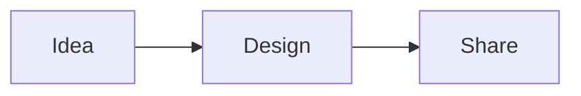

# Write for the Grida Blog

This guide is for writers adding or editing articles at [grida.co/blog](https://grida.co/blog). You can do the whole process on GitHub in your browser.

## Add an article

1. Open [`content/posts`](content/posts) on GitHub and choose **Add file → Create new file**.
2. Name the file with lowercase words separated by hyphens, for example `designing-with-grida.mdx`.
3. Copy the [post template](content/_template.mdx.example) into the new file and replace its sample text.
4. Choose **Commit changes**, select **Create a new branch**, and open a pull request. Add a short description of the article and anything you want reviewers to check.

The file is picked up automatically. You do not need to change application code or add it to a list.

Start each article with its details between `---` lines:

```mdx
---
title: Designing with Grida
description: A practical guide to building your first design on Grida Canvas.
date: 2026-11-10
authors: universe
tags: [canvas, design]
draft: true
---

An opening paragraph that explains what the reader will learn.

## Start with a shape

Write the article here.
```

`title`, `description`, `date`, and `authors` are required. Write a clear description for search results and use `YYYY-MM-DD` for the date. Author IDs come from [`content/authors.yml`](content/authors.yml); multiple authors can be written as `authors: [universe, ramunarasinga]`.

The filename becomes the URL: `designing-with-grida.mdx` appears at `https://grida.co/blog/designing-with-grida`. An optional `slug: designing-with-grida` keeps that URL fixed if you rename the file later. Keep existing published slugs unchanged so shared links continue to work.

Tags are optional. Use lowercase words separated by hyphens, such as `design-tools`. New tags get their own pages automatically. [`content/tags.yml`](content/tags.yml) lets you give a tag a display label or description, but adding a tag there is optional.

## Add or replace images

Upload images into `public/images/<article-slug>/`. On GitHub, choose **Add file → Upload files** in the appropriate folder. Use descriptive filenames without spaces.

In your article, include `/blog` in the image path:

```md

```

`public/images/designing-with-grida/centered-rectangle.webp` is served at `/blog/images/designing-with-grida/centered-rectangle.webp`. The words inside `[]` describe the image for readers who cannot see it.

To replace an image without editing the article, upload its replacement at the same filename. To choose a cover and social sharing image, add this optional frontmatter field:

```yaml
image: /blog/images/designing-with-grida/cover.webp
```

Without `image`, the article list uses the first image in the article, and social sharing uses the Grida blog card.

## Preview and publish

Changes on a branch do not change the published blog. Once the Vercel Git integration is connected, open the deployment preview linked from your pull request and visit `/blog` to review it.

`draft: true` excludes an article from every build, including preview pages, article URLs, feeds, and the sitemap. To preview the finished article in your branch, remove that line or set `draft: false`; it still does not change the production blog until the pull request is merged into `main`.

Before merging, review the preview on a phone-sized screen and check the article text, images, links, author, and date. Wait for checks and the deployment to pass. Merging into `main` starts the production deployment. After it succeeds, open the article at `grida.co/blog` to confirm it is live.

For an existing article, open its file in [`content/posts`](content/posts), choose the pencil icon, make your edits, and follow the same branch and pull request process. Reverting an unwanted content change is another pull request; the repository keeps its history.

## Formatting and embeds

Use ordinary Markdown for paragraphs, `##` headings, lists, links, code blocks, and tables. The article title already appears above the body, so start body sections at `##`.

Link to other posts using their published paths, for example `[Read about snapping](/blog/snap-on-canvas)`. Link to documentation using `https://grida.co/docs/...`.

Vimeo embeds work without an import:

```mdx
<VimeoEmbed videoId="1165652748" title="A demonstration of refig" />
```

Mermaid diagrams use a fenced code block:

````md

````

## Add an author

Add an entry to [`content/authors.yml`](content/authors.yml), then use its ID in the article's `authors` field:

```yaml
new-author:
  name: Writer Name
  title: Designer at Grida
  url: https://github.com/your-username
  image_url: /blog/authors/new-author.png
```

Only `name` is required for an author. If you include a portrait, upload it to `public/authors/` using the filename in `image_url`.

## If a preview fails

Read the failed check or deployment log linked from the pull request. Common causes are a missing required field, an author ID absent from `authors.yml`, an invalid date, duplicate slugs, an image path that does not match the uploaded filename, or an unclosed MDX tag.

Keep the opening and closing `---` lines. If a title or description contains a colon, wrap the whole value in quotes. Image filenames are case-sensitive. Fix the file and commit again to the same branch; the checks and preview update automatically.

If you use a local checkout, run `npm run check` and `npm run build` before opening the pull request. Setup commands are in the [README](README.md).
